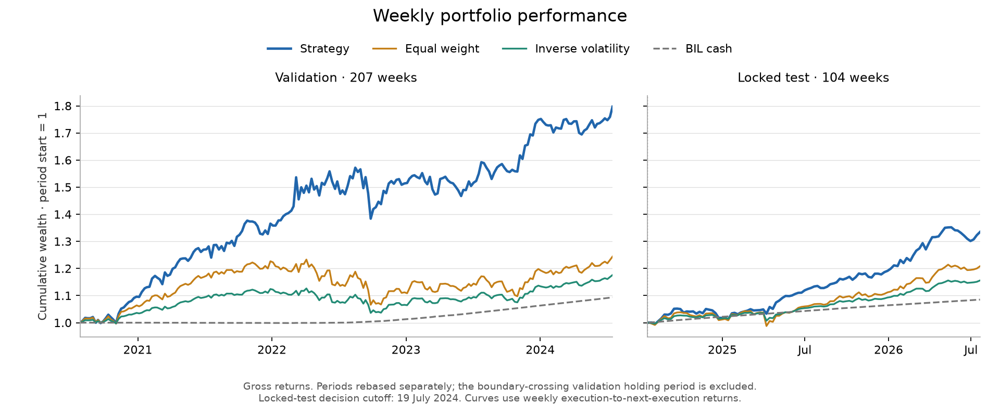
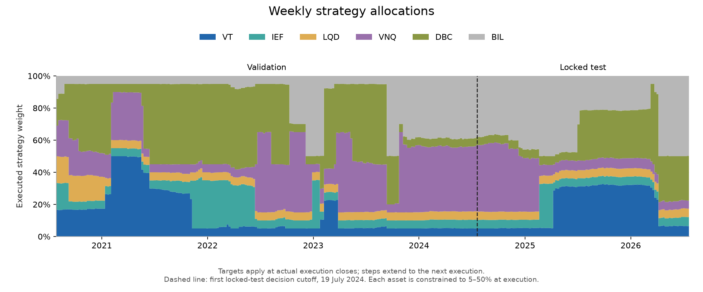

# Regime-Aware Dynamic Asset-Class Allocation

## Introduction

This project studies weekly allocation across six asset-class proxies using causal regime probabilities, pooled four-week return forecasts, and constrained portfolio optimization. A reproducible historical backtest compares the strategy with equal-weight and inverse-volatility benchmarks, with separate validation and locked-test results.

## Data and attribution

| Input | Source, units, and frequency |
| --- | --- |
| Market histories | Yahoo Finance chart JSON, retrieved with `requests`: `VT` global equities, `IEF` government bonds, `LQD` investment-grade credit, `VNQ` real estate, `DBC` commodities, and `BIL` cash. Daily distribution- and split-adjusted prices support the return and execution calculations. |
| Equity volatility | Chicago Board Options Exchange, [CBOE Volatility Index: VIX (`VIXCLS`)](https://fred.stlouisfed.org/series/VIXCLS), daily closing index, retrieved through FRED/ALFRED, Federal Reserve Bank of St. Louis. |
| Treasury term spread | Federal Reserve Bank of St. Louis, [10-Year Treasury Constant Maturity Minus 2-Year Treasury Constant Maturity (`T10Y2Y`)](https://fred.stlouisfed.org/series/T10Y2Y), daily percentage-point spread, retrieved through FRED/ALFRED. |
| Producer prices | U.S. Bureau of Labor Statistics, [Producer Price Index by Commodity: All Commodities (`PPIACO`)](https://fred.stlouisfed.org/series/PPIACO), monthly index, 1982 = 100, retrieved through FRED/ALFRED. |

Prices cover 3,028 required sessions per asset, from 25 July 2014 through 10 August 2026. The initial boundary supports the first weekly return; the final endpoint completes the last four-week target. Macro history includes four preceding weekly cutoffs. No required sessions or macro cutoffs are missing.

The [retrieval manifest](results/retrieval_manifest.json) records 32 exact response snapshots, source identifiers, request parameters, retrieval times, release IDs, vintage coverage, hashes, and reconstruction instructions. Provider observations and prepared prices, features, and targets remain in ignored `data/`. Published forecasts, regime probabilities, allocations, and portfolio returns are constructed or simulated research quantities.

Source rights remain with their owners. VIX and the term-spread series require attribution; PPIACO is identified as public-domain data with citation requested. [FRED API access does not override series-owner restrictions](https://fred.stlouisfed.org/docs/api/terms_of_use.html). [Yahoo's general terms](https://legal.yahoo.com/us/en/yahoo/terms/otos/index.html) restrict automated collection and reuse, and its [Finance terms](https://legal.yahoo.com/us/en/yahoo/terms/product-atos/finance/index.html) also apply. The repository grants no rights to redistribute provider observations or refresh them without applicable permissions. The manifest records the 31 October 2026 terms review.

Software attribution: pandas, NumPy, scikit-learn, hmmlearn, CVXPY with CLARABEL, joblib, Matplotlib, requests, and exchange-calendars. The environment also includes yfinance and fredapi; retrieval uses direct HTTP requests, and adjustment follows yfinance's adjusted-close/raw-close ratio.

## Construction

### Research calendar and information availability

Research index $t$ identifies a consecutive Monday-start, seven-day week. The XNYS calendar resolves holidays, early closes, daylight saving time, and extraordinary closures.

| Symbol | Timestamp or quantity |
| --- | --- |
| $C_t$ | Friday decision cutoff: the actual exchange close, or 16:00 New York time when Friday is closed. |
| $F_t$ | Latest available trading close at or before $C_t$, used for price predictors and reference holdings. |
| $E_t$ | Following Monday's execution close, advanced to the next trading close if Monday is closed. |
| $H_t$ | Close four calendar weeks after the actual execution date, advanced to the next session if closed. |
| $P^a_s$ | Distribution- and split-adjusted price of asset $a$ at close $s$. |

Adjusted OHLC prices equal raw OHLC multiplied by adjusted close divided by raw close. Ratios of adjusted closes supply total returns.

Macro observations use the vintage available at each cutoff. Because historical intraday release/ingestion times are unavailable, each vintage becomes eligible at the next midnight in `America/New_York` after its vintage date. Carry-forward stops when its eligible vintage interval ends; later revisions cannot fill unavailable values. [ALFRED's documentation](https://alfred.stlouisfed.org/help) explains vintage and release dates.

### Returns, predictors, and targets

Weekly total and excess returns are

$$r^a_t=P^a_{F_t}/P^a_{F_{t-1}}-1,\qquad e^a_t=r^a_t-r^{BIL}_t.$$

Return predictors are $e^a_{t-1}$, trailing 4-, 13-, and 52-week compounded excess returns $\prod(1+e^a)-1$, and sample standard deviations over those windows. Trailing windows end at the current known Friday close. Macro predictors comprise available levels and four-week changes: differences for VIX and the term spread, and fractional percentage change for PPI. Each historical level is the value known at its own cutoff.

The supervised four-week target, expressed as a return fraction, is

$$y^a_t=(P^a_{H_t}/P^a_{E_t}-1)-(P^{BIL}_{H_t}/P^{BIL}_{E_t}-1).$$

A training row from origin $i$ is eligible only when $i<t$ and $H_i\leq C_t$, within the configured calendar lookback and after warm-up. This maturity rule also governs earlier locked-test labels entering later scheduled refits.

### Execution, holdings, and turnover

Existing adjusted-price units $u_{t-1}$ represent distribution-reinvested holdings. Valuing them at $F_t$ gives the normalized Friday reference weights $w^F_t$; valuing them at $E_t$ gives pre-trade weights $w^-_t$ and NAV $V_t$. For target weights $w_t$,

$$u^a_t=V_t w^a_t/P^a_{E_t},\qquad R_t=u_t^\top P_{E_{t+1}}/V_t-1.$$

Executed weights $w^{exec}_t$ are the normalized post-trade values. Realized one-way turnover is

$$T_t=\tfrac12\lVert w^{exec}_t-w^-_t\rVert_1.$$

Targets take effect only at execution. Holdings drift until the next trade, so overlapping four-week forecasts are not treated as independent four-week portfolio positions. The cash comparison uses the execution-to-next-execution BIL return $R^{BIL}_t$.

## Statistical and mathematical models

### Regime identification

Three univariate Gaussian HMMs model VIX level, term-spread level, and four-week fractional PPI change. Each fit standardizes its origin-available history using the training-window mean and population standard deviation, with shorter history during initialization. EM estimation enforces the specified variance floor after every M step.

For standardized observation $z_t$, transition matrix $A$, and state $s$, forward filtering computes

$$\alpha_t(s)\propto p(z_t\mid s)\sum_j A_{js}\alpha_{t-1}(j),$$

with normalization at every observation. States are ordered by ascending emission mean. Historical feature rows retain their own origin-time fit and filtered probabilities; no backward smoothing or later-data refit is applied to them. A higher-mean state describes its emission, rather than a common economic risk ranking across all three models.

### Pooled return forecasting

A pooled `HistGradientBoostingRegressor` estimates $\mu^a_t$, the four-week excess-return forecast, from the constructed predictors, all six HMM probability columns, and a categorical asset identifier. It pools the five non-cash assets, uses squared-error loss, and refits weekly on eligible rows. BIL's excess forecast is fixed at zero.

### Covariance and constrained allocation

Ledoit–Wolf estimates covariance from available weekly total returns across all six assets. Weekly covariance is multiplied by four to match the forecast horizon: $\Sigma_{4,t}=4\Sigma_{weekly,t}$.

CVXPY/CLARABEL solves

$$
\begin{aligned}
\max_w\quad &\mu_t^\top w-\frac{\lambda}{2}w^\top\Sigma_{4,t}w-\gamma\lVert w-w^F_t\rVert_1\\
\text{subject to}\quad &\sum_a w_a=1,\qquad 0.05\leq w_a\leq0.50.
\end{aligned}
$$

The penalty discourages changes from the Friday reference defined above. It is not deducted from NAV as a trading cost.

### Evaluation

Forecast error is the pooled mean squared error across scored origins and the five non-cash assets. Within each evaluation period, reindex scored weekly execution returns as $R_1,\ldots,R_n$ and define $Z_t=R_t-R^{BIL}_t$:

- Annualized return: $[\prod_{t=1}^n(1+R_t)]^{52/n}-1$.
- Annualized volatility: $\sqrt{52}\,s(R)$.
- Excess-return Sharpe: $\sqrt{52}\,\overline{Z}/s(Z)$.
- Maximum drawdown: $\min_t[W_t/\max_{j\leq t}W_j-1]$, where $W_0=1$ and $W_t=\prod_{i=1}^t(1+R_i)$.
- Mean weekly turnover: $n^{-1}\sum_t T_t$.

Here $s$ is the sample standard deviation. Each evaluation period is scored separately.

## Configurations and benchmarks

| Setting | Configuration |
| --- | --- |
| Research sample | 624 consecutive weeks beginning 28 July 2014; 52 observations per year for annualization. |
| Splits | Warm-up 1–52; initial training 53–312; validation 313–520; locked test 521–624. |
| Return-model training | Previous 260 calendar-origin weeks, starting no earlier than week 53; only mature targets. |
| HMM history and states | Up to 260 observations; initialization after eight; two states with diagonal covariance. |
| HMM estimation | Variance floor 0.001; `covars_prior=0`; `n_iter=200`; `tol=0.001`; up to 20 named seeded attempts for unusable fits. |
| Boosting | Squared-error loss; `early_stopping=False`. |
| Covariance history | Latest 260 available weekly total-return observations, including the current Friday. |
| Initialization and accounting | Equal weights at the first validation Friday close; gross returns with zero transaction costs, slippage, and taxes. |

### Search ranges and selected settings

| Setting | Validation grid | Frozen choice |
| --- | --- | --- |
| `learning_rate` | 0.01–0.10, step 0.01 | 0.01 |
| `max_iter` | 100–500, step 100 | 100 |
| `max_leaf_nodes` | 5–15, step 1 | 5 |
| `min_samples_leaf` | 5–25, step 5 | 25 |
| `l2_regularization` | $10^{-1},10^{-2},10^{-3},10^{-4},10^{-5}$ | $10^{-5}$ |
| Risk aversion $\lambda$ | 1–5, step 1 | 3 |
| Turnover penalty $\gamma$ | 0.001–0.005, step 0.001 | 0.005 |

All 13,750 return-model combinations were fitted at all 208 validation origins, giving 2,860,000 fit calls. Within an otherwise identical parameter group, the five iteration checkpoints share boosting trees; equivalence to independent fits is tested. The return model minimizes pooled validation MSE; the 25 allocation combinations then maximize validation excess-return Sharpe. Exact ties select the lowest permanent Cartesian candidate ID.

Selection uses only outcomes realized before the first locked cutoff, 19 July 2024. Four-week targets from origins 517–520 are excluded, leaving 204 scored forecast origins. The origin-520 weekly holding interval also crosses that cutoff, leaving 207 scored validation returns; its executed holdings still carry into locked testing.

`MASTER_SEED=42`. NumPy `SeedSequence` children use fixed component, forecast-origin, candidate, and repeated-fit IDs, independent of execution order. [The frozen configuration](artifacts/frozen_config.json) records selected settings, grids, seed reconstruction, HMM attempts, feature/allocation rules, and code, environment, and input provenance. Choices were fixed before locked testing and remain unchanged.

### Benchmarks

Equal weight rebalances to six equal targets. Inverse volatility uses reciprocal sample volatilities from 52 available Friday total returns, normalizes them, then applies Euclidean projection onto the allocator's feasible weight set. Both rebalance on the strategy's execution schedule and use the same holdings accounting. BIL is an additional cash reference.

## Results

| Evaluation | Scored weekly return interval | Weekly returns | Non-cash forecast MSE |
| --- | --- | ---: | ---: |
| Validation | 27 July 2020–15 July 2024 | 207 | 0.001645741 |
| Locked test | 22 July 2024–20 July 2026 | 104 | 0.001226289 |

MSE uses squared return fractions: 1,020 scored non-cash targets in validation and 520 in locked testing. The final target endpoint is 10 August 2026; observations beyond research week 624 only complete already-issued forecasts and holdings.

| Period | Portfolio | Ann. return | Ann. volatility | Excess Sharpe | Max. drawdown | Mean turnover |
| --- | --- | ---: | ---: | ---: | ---: | ---: |
| Validation | Strategy | 15.86% | 11.93% | 1.10 | −11.96% | 3.01% |
| Validation | Equal weight | 5.63% | 8.28% | 0.43 | −13.54% | 0.54% |
| Validation | Inverse volatility | 4.15% | 4.87% | 0.40 | −8.02% | 0.58% |
| Validation | BIL cash | 2.26% | 0.34% | — | −0.15% | 0.00% |
| Locked test | Strategy | 15.52% | 6.19% | 1.70 | −3.81% | 1.66% |
| Locked test | Equal weight | 9.91% | 6.22% | 0.89 | −5.28% | 0.51% |
| Locked test | Inverse volatility | 7.50% | 3.65% | 0.88 | −2.92% | 0.37% |
| Locked test | BIL cash | 4.17% | 0.11% | — | 0.00% | 0.00% |

BIL's excess Sharpe is undefined because its excess return over itself is zero. In this locked period the strategy has higher gross return and Sharpe than both rebalanced benchmarks, but a larger drawdown than inverse volatility.



Each panel starts at wealth one and omits the boundary-crossing validation interval. Strategy volatility and drawdown are lower in the locked period than in validation.



The chart shows executed targets as steps; holdings drift between executions. The dashed line marks the first locked decision. BIL takes a substantial share of the portfolio, and the asset mix shifts across the sample.

## Setup and reproduction

The tested environment is Windows x86-64 with CPython 3.12.14. [requirements.txt](requirements.txt) pins all direct and transitive runtime dependencies. Reuse the existing `.venv`; for a fresh setup:

```powershell
py -3.12 -m venv .venv
$env:PATH = (Join-Path (Get-Location) '.venv\Scripts') + ';' + $env:PATH
python -m pip install -r requirements.txt
$env:OMP_NUM_THREADS = '1'
$env:OPENBLAS_NUM_THREADS = '1'
python -m pip check
```

Supply `FRED_API_KEY` through the process environment before data preparation. No credential values or `.env` files are distributed. The thread variables above are reproducibility settings.

Exact research reproduction requires the manifest-listed private snapshots and adjacent metadata restored under `data/raw/`. The data stage rebuilds seven prepared tables and checks cached responses. Without snapshots it attempts provider retrieval, subject to access permissions; revised downloads may fail the frozen input hashes. Published results and figure regeneration do not require the observation cache.

The research entry point is `run_pipeline.py`. The following commands were tested in the recorded environment:

```powershell
python run_pipeline.py --stage data
python run_pipeline.py --stage select
python run_pipeline.py --stage test
python run_pipeline.py
python -c "from regime_allocation.reporting import export_figures; export_figures()"
python -m unittest discover -s tests
python -c "from regime_allocation.reproduction import verify_reproduction; verify_reproduction()"
```

With the frozen artifact present, selection verifies and preserves its choices. The first test invocation performs 104 scheduled return refits, appends separately identified results, and writes [a completion receipt](artifacts/locked_test_receipt.json). Subsequent invocations, including the default workflow, verify and reuse that assessment. Figure rendering reads sealed tables without changing choices. The retrieval manifest describes input preparation; the receipt is the authoritative assessment state.

The final command performs a clean computational replay. It preserves completed outputs, creates an isolated workspace under ignored `data/`, and copies raw snapshots, source code, frozen choices, and validation grid scores. No prepared tables, fitted-model caches, or test receipt are copied. It rebuilds the 208 selected validation fits and origin-time HMMs, verifies the frozen handoff, then runs `python run_pipeline.py` for the 104-origin locked replay. Grid search is not repeated, and locked results cannot revise choices. The original assessment remains untouched; temporary files are removed after verification.

The [verification record](artifacts/reproduction_verification.json) reports byte-identical reproduction of all six scientific CSVs and both figures, with zero observed numeric difference. All 55 correctness tests pass, and accounting checks reconcile all 936 strategy/benchmark executions. One recorded warm-up HMM initialization required its next seed; no unresolved HMM or solver failures remain.

### Integrity and numerical tolerances

CSV exports retain 17 significant digits. SHA-256 checks protect inputs and results; source hashes normalize line endings, and frozen JSON has a canonical seal. Clean comparisons require exact identifiers, timestamps, unavailable-value patterns, and table structure, with absolute numeric differences no greater than $10^{-10}$. Administrative generation/completion timestamps are excluded from scientific comparisons.

| Check | Tolerance or limit |
| --- | --- |
| Weight bounds and sum | $10^{-7}$ |
| Self-financing NAV | $10^{-10}$ absolute |
| Covariance symmetry/PSD | $10^{-12}$ |
| CLARABEL feasibility and gaps | $10^{-10}$; maximum 500 iterations |
| HMM convergence | Final likelihood improvement in $[-10^{-7},\,0.001)$ |

Unusable inputs and unresolved fit/solver failures stop reporting rather than substitute data or allocations.

## Repository and outputs

| Location | Contents |
| --- | --- |
| [README.md](README.md) | Methodology, results, attribution, and reproduction. |
| [.gitignore](.gitignore), [.gitattributes](.gitattributes) | Private-data exclusions and reproducible text line endings. |
| [requirements.txt](requirements.txt) | Tested pinned dependencies. |
| [run_pipeline.py](run_pipeline.py) | Research execution entry point. |
| [Package initialization](regime_allocation/__init__.py), [configuration](regime_allocation/config.py) | Shared paths, calendar, settings, grids, and named seeds. |
| [Data retrieval](regime_allocation/data.py), [features](regime_allocation/features.py) | Snapshots, availability, adjusted returns, predictors, and targets. |
| [Models](regime_allocation/models.py), [portfolio](regime_allocation/portfolio.py) | Causal HMM features, pooled forecasts, selection, optimization, and holdings. |
| [Evaluation](regime_allocation/evaluation.py), [reporting](regime_allocation/reporting.py) | Separate-period scoring, integrity checks, and figures. |
| [Reproduction verifier](regime_allocation/reproduction.py) | Isolated frozen-choice replay and preserved-output comparisons. |
| [tests/test_project.py](tests/test_project.py) | Mathematical, causal, timing, accounting, seed, and reproduction checks. |
| [Frozen configuration](artifacts/frozen_config.json) | Choices, grids, seed mappings, provenance, and validation hashes. |
| [Locked-test receipt](artifacts/locked_test_receipt.json) | Assessment state, 104 return fits, frozen seal, and final table hashes. |
| [Reproduction verification](artifacts/reproduction_verification.json) | Clean-run environment, provenance, and file comparisons. |
| [Retrieval manifest](results/retrieval_manifest.json) | Input coverage, attribution/terms, snapshot hashes, and reconstruction. |
| [Selection](results/selection.csv) | Scores, coverage, and choices for all 13,775 grid combinations. |
| [Weekly forecasts](results/weekly_forecasts.csv) | Forecasts, targets, maturity, and decision/execution/realization times. |
| [Regime probabilities](results/regime_probabilities.csv) | Filtered probabilities, ordered means, windows, seeds, and convergence. |
| [Weekly allocations](results/weekly_allocations.csv) | Targets, reference/pre-trade/executed weights, units, NAV, turnover, and solver diagnostics. |
| [Weekly returns](results/weekly_returns.csv), [performance](results/performance.csv) | Separate-period strategy, benchmark, and cash returns and comparative measures. |
| [Performance figure](results/figures/performance.png), [allocation figure](results/figures/allocations.png) | Cumulative performance and executed weights across both periods. |

## Assumptions and limitations

- Four-week targets overlap. Their MSE is descriptive, rather than evidence from independent observations; portfolio performance uses weekly holdings returns.
- A large validation grid selected the settings. The single locked historical sample does not establish persistent or net outperformance.
- BIL is an ETF cash proxy, not a guaranteed risk-free instrument. Gross results omit commissions, spread, market impact, financing details, taxes, and execution uncertainty.
- Four-times-weekly covariance, Gaussian two-state regimes, and rolling estimation windows are modeling assumptions. Statistical state labels do not establish economic mechanisms.
- Historical market-data revision vintages and exact macro intraday release times are unavailable. Current Yahoo history is snapshotted; conservative macro timing cannot remove every source limitation.
- Bounds apply at execution and can be breached by subsequent drift. Evaluation periods are rebased separately, with the boundary-crossing validation interval omitted.
- Exact reconstruction depends on the original private inputs and pinned environment. Provider observations are not redistributed, and new downloads may not match recorded hashes.
